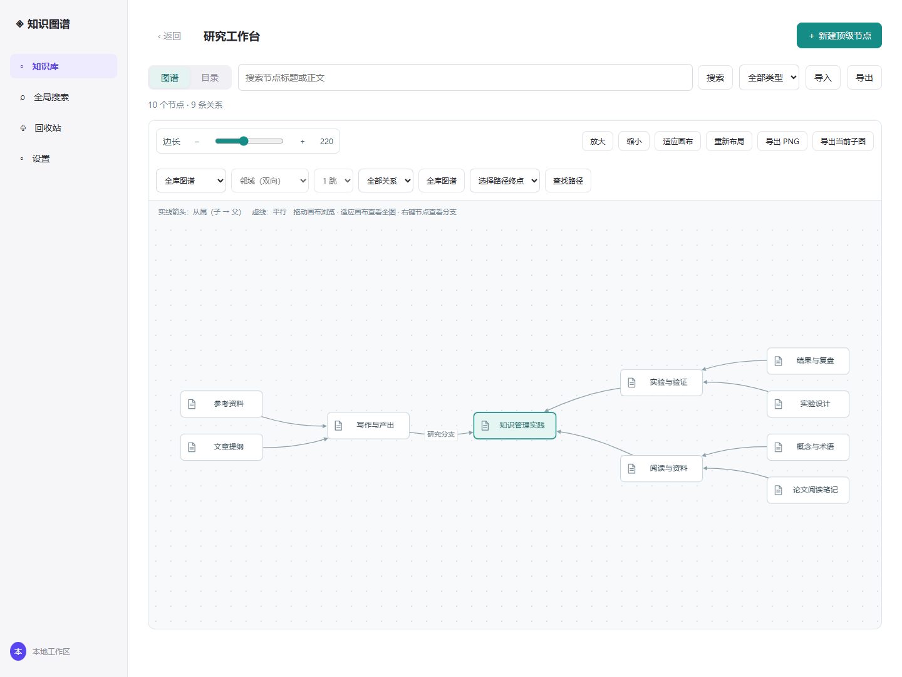
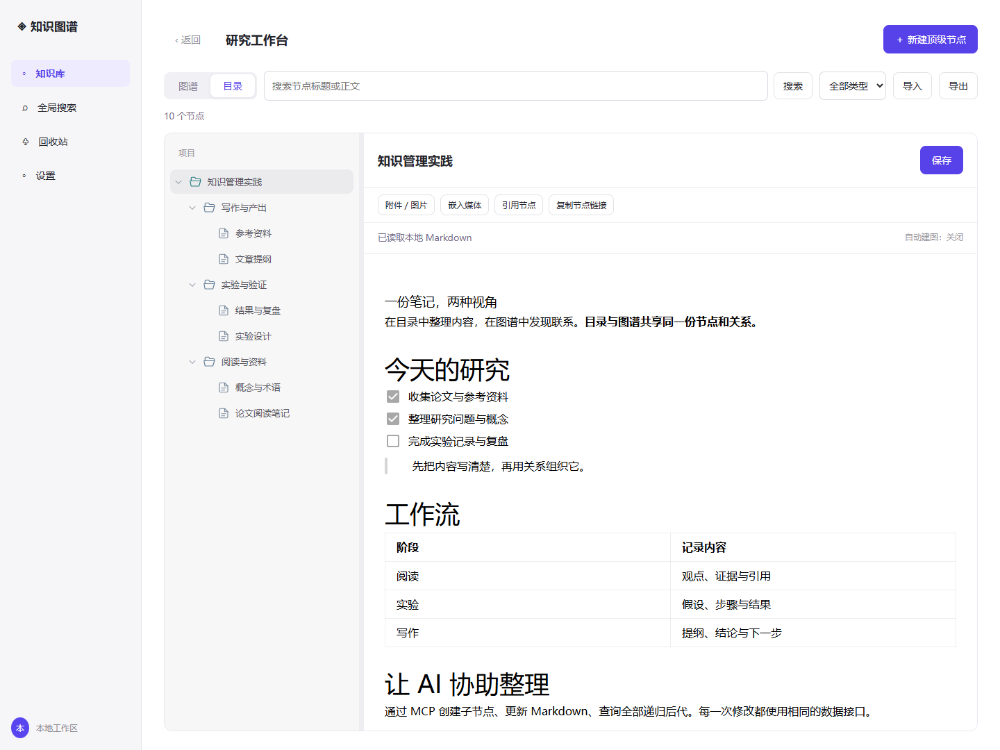
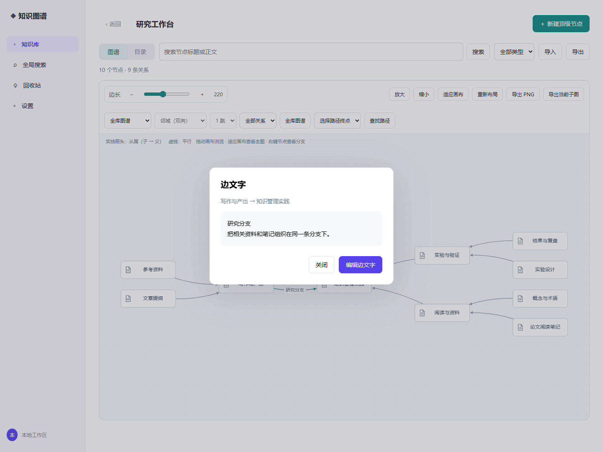

<div align="center">

# Graph KB

### 用 Markdown 写作，用图谱组织知识。

本地桌面知识库 · 同一份数据，两种视角 · 让 AI 通过 MCP 协助整理

**Windows x64** &nbsp; / &nbsp; **v0.2.6 · 本地 MVP** &nbsp; / &nbsp; **Apache-2.0**

[快速开始](#quick-start) · [使用指南](#usage) · [配置 MCP](#mcp) · [备份与迁移](#backup) · [开发文档](docs/DEVELOPMENT.md)

</div>



<p align="center"><sub>实际应用界面，使用独立演示知识库。截图可通过 <code>node scripts/capture-readme.mjs</code> 重新生成。</sub></p>

## 图谱就是底层结构

Graph KB 是一款基于 **Tauri + Kùzu + Milkdown + Cytoscape.js** 的本地知识管理应用。

每个节点是一份可编辑的 Markdown 文档，关系决定它如何被组织。目录和图谱展示同一份数据；一个节点可以同时属于多个父节点，正文仍只有一份。每个知识库拥有独立的图数据库、文档和附件目录，便于备份与迁移。

| 组织内容 | 阅读与写作 | 连接 AI |
| :--- | :--- | :--- |
| 目录 / 图谱随时切换 | Milkdown 所见即所得编辑 | 内置 35 项 MCP 工具 |
| 多父节点、完整递归子图 | 标题、列表、待办、表格、代码块 | 通过同一接口读写节点和关系 |
| 节点与边自定义属性¹ | 附件、媒体、跨库引用、全文搜索 | 可选云端概念抽取 |
| 整库备份、迁移与副本导入 | 版本冲突保护、删除与恢复 | 固定连接配置，重启读取新会话 |

<sub>¹ 自定义属性目前通过 API/MCP 管理，尚无图形化属性编辑面板。</sub>

<a id="quick-start"></a>
## 快速开始

### 使用桌面安装包

适用于 **Windows x64**。运行项目维护者提供或自行构建的 `Graph KB_0.2.6_x64-setup.exe`，完成安装后启动 Graph KB。

- 安装包内置 Node.js、Kùzu 和本地服务，使用者不需要另装 Node 或 Rust。
- 需要 WebView2；安装器按 Tauri 配置检测和处理。当前构建未签名。
- 本仓库不包含安装包二进制。没有安装包时，可从源码运行；打包步骤见 [开发文档](docs/DEVELOPMENT.md)。

### 从源码体验

安装 **Node.js 24+（含 npm）**，下载或克隆本仓库，在项目目录执行：

```powershell
npm ci
npm run dev
```

浏览器打开 **http://127.0.0.1:1420**。开发模式使用 `.graph-kb/dev/`，与桌面数据隔离；关闭开发进程后，本地服务停止。

> 普通笔记、图谱和 MCP 读写不需要云端 API Key。只有启用云端自动建图时，才需要配置模型服务。

<a id="usage"></a>
## 五分钟上手

### 1. 创建知识库和文档

1. 首页新建知识库并进入。
2. 点击 **新建顶级节点**，输入标题，一般选择默认的“页面”类型即可。
3. 在目录中左键节点，在右侧编辑 Markdown。
4. 点击 **保存** 或按 **Ctrl+S**，保存后再切换文档。
5. 右键已有节点 → **新建子节点**，继续建立层级。



标题、保存按钮和附件工具栏固定在编辑区顶部。目录与编辑器之间的分隔条可以拖动；有子节点时显示文件夹图标，该节点本身仍可以写正文。

### 2. 切换视图、查找内容

| 操作 | 目录视图 | 图谱视图 |
| :--- | :--- | :--- |
| 左键节点 | 在右侧编辑正文 | 在独立文档窗口打开 |
| 右键节点 | 创建子节点、重命名、管理关系、删除、打开分支或新窗口 | 相同的节点操作菜单 |
| 调整展示 | 折叠 / 展开目录，拖动分隔条 | 拖动节点和画布、缩放、调节边长、重新布局 |
| 搜索 | 输入后自动筛选，也支持回车或“搜索”按钮 | 按相同条件筛选图谱 |

搜索匹配**已保存的标题和正文**，不包含未保存的草稿。目录会保留并展开匹配项的父级路径。

**查看一个完整分支：** 右键节点 → **只看此节点及全部子节点**。包含该节点和全部层级的后代，共享后代只显示一次，不带入祖先、兄弟或外部父节点。点击 **全库图谱** 退出范围，其他搜索和类型筛选仍保留。

**一跳 / 两跳 / 三跳：** 选择中心后，按最多经过几条边查询双向邻域，父节点和子节点都可能出现。它与“不限深度、只向下查询”的全部递归子节点是两种范围。

深层大图默认保持可读比例，可拖动画布浏览；**适应画布** 查看完整概览。共享节点的额外连线会保留，复杂多父图仍可能交叉。

### 3. 给关系写说明

右键边 → **编辑边文字** → 保存。第一行显示在图上，第二行起隐藏；左键点击边可查看完整说明，避免长文字挤满画布。最多 200 字符。

<details>
<summary><strong>查看边文字窗口</strong></summary>



</details>

关系有两种：`CHILD_OF` 为**子 → 父**；`SIBLING_OF` 为同库顶级节点之间的平行关系。结构关系不能跨库、不能形成从属环；跨库引用通过正文中的节点链接完成。

### 4. 附件、引用与类型

编辑工具栏提供 **附件 / 图片**、**嵌入媒体**、**引用节点** 和 **复制节点链接**；引用节点支持选择其他知识库。

可创建 **页面、标签、文件、人物、任务** 五种节点，目前主要用于分类与筛选，都有 Markdown 正文。任务尚无提醒、截止日期等独立功能。后台 **Concept** 由云端抽取生成，普通目录与图谱不展示，用于共享概念关联与相关文档查询。

### 5. 删除与恢复

- **仅删除当前节点**：保留其他节点，失去父节点的文档可能提升为顶级节点。
- **级联删除**：连同独占后代删除，保留有外部父节点的共享后代及其分支。
- 两种删除均进入**回收站**，保留 30 天；按批次恢复，无法恢复的冲突关系会提示。

<a id="mcp"></a>
## 让 AI 通过 MCP 使用知识库

Graph KB 内置**本机 stdio MCP 服务**。AI 客户端直接调用节点、文档、图谱、导入导出等工具，与界面共用同一数据接口；不需要模拟点击窗口，也不是远程 HTTP MCP 地址。

### 第一步：获取固定配置

启动 Graph KB，打开 **设置 → 开放 API / MCP → 显示本地连接配置**，复制完整 JSON。优先使用应用生成的真实路径，下面仅为格式示例：

```json
{
  "mcpServers": {
    "graph-kb": {
      "command": "C:/Apps/Graph KB/resources/runtime/node.exe",
      "args": ["C:/Apps/Graph KB/resources/runtime/server/mcp.mjs"],
      "env": {
        "GRAPH_KB_CONNECTION_FILE": "C:/Users/YOUR_USER/AppData/Local/local.graph-kb.phase0/mcp-session.json"
      }
    }
  }
}
```

三个路径必须是**绝对路径**。`C:/Apps/Graph KB` 和 `YOUR_USER` 是示例，不可原样使用。开发模式导出的路径会指向源码目录与开发数据目录。

### 第二步：添加到客户端

**支持 `mcpServers` JSON 的客户端：** 将 `graph-kb` 条目合并到客户端的 MCP 配置，保留其他服务，再重新加载。不同客户端的配置位置和顶层格式可能不同，以该客户端要求为准。

**Codex：** 将应用导出的完整 JSON 保存到项目中的 `.tools/mcp-connection.json`，保持 Graph KB 运行，然后执行：

```powershell
# 只验证连接，不修改 Codex 配置
node scripts/connect-codex.mjs --check

# 验证成功后注册为用户级 graph-kb 服务
node scripts/connect-codex.mjs

# 查看已注册服务
codex mcp list
```

接入脚本需要 Node.js 与可用的 Codex CLI。CLI 不在 PATH 时，可设置 `GRAPH_KB_CODEX_COMMAND` 为 `codex.exe` 的绝对路径。`.tools/` 已被 Git 忽略，勿公开本机配置。

<details>
<summary><strong>不用接入脚本：手动配置 Codex</strong></summary>

将下面条目添加到用户的 `~/.codex/config.toml`，替换为应用导出的实际路径；已有同名条目时修改原条目，不要重复追加。

```toml
[mcp_servers.graph-kb]
command = 'C:\Apps\Graph KB\resources\runtime\node.exe'
args = ['C:\Apps\Graph KB\resources\runtime\server\mcp.mjs']

[mcp_servers.graph-kb.env]
GRAPH_KB_CONNECTION_FILE = 'C:\Users\YOUR_USER\AppData\Local\local.graph-kb.phase0\mcp-session.json'
```

Codex 支持 CLI 和 `config.toml` 配置 stdio MCP，参见 [OpenAI 官方文档](https://developers.openai.com/codex/mcp)。

</details>

首次注册或升级工具定义后，重新加载客户端的 MCP 服务；必要时重新打开会话。在 Codex CLI 中可用 `/mcp` 检查当前会话加载的服务。

### 第三步：验证并开始使用

先让 AI 调用 `get_usage_guide`，再调用 `list_kbs`。能返回手册和真实知识库列表，才说明业务连接可用。

可以这样提出任务：

> 通过 Graph KB MCP 在后台操作。先读使用指南，在“研究工作台”的“论文阅读笔记”节点下创建“本周阅读”，写入我接下来提供的 Markdown。

> 查看“知识管理实践”节点及全部递归子节点，概括每个分支的内容。不要修改数据。

| 任务 | 常用工具 |
| :--- | :--- |
| 了解使用方式 | `get_usage_guide`，或资源 `graph-kb://guide/usage` |
| 定位库与节点 | `list_kbs`、`list_nodes`、`search`、`get_graph` |
| 读取 / 保存正文 | `get_node`、`update_doc` |
| 创建子节点 | `create_node`，指定 `kbId` 和 `parentId` |
| 查询全部后代 | `get_graph`，指定 `center` 和 `scope: "descendants"` |
| 编辑关系与属性 | `create_edge`、`update_edge`、`update_node` |
| 备份与恢复 | `export_database`、`import_database`、`list_trash`、`restore` |

详细例子见 [MCP 使用指南](server/mcp-guide.md) 和 [API 参考](docs/API.md)。修改正文前读取最新 `revision`；`update_doc` 提交完整 Markdown，冲突时先重读合并。

### 三个容易混淆的地方

1. **应用需要运行。** 最小化后可后台调用；关闭窗口会退出服务。仅使用指南可在应用关闭时读取。
2. **固定 JSON 不含临时令牌。** 应用重启后，MCP 下一次业务调用自动读取新会话；更换安装或数据目录后才需重新获取配置。不要提交 `mcp-session.json`。
3. **MCP 与 Computer Use 是两种入口。** `@Graph KB` 若指向 Computer Use，只代表界面自动化；连接成功的 MCP 应能发现 `get_usage_guide`、`list_kbs` 等工具。

## 可选：云端自动建图

设置中选择 **DeepSeek、OpenAI/GPT、Google Gemini、MiMo 或兼容服务**，填写模型 ID 和自己的 API Key，开启自动建图并保存设置。

保存时先完成本地写入，再将正文发送给所选服务提取概念。失败会提示“已保存到本地 · 抽取失败”，不会撤销正文。自动化测试使用模拟响应，真实抽取质量需结合所选模型验证。

API Key 仅保留在本次进程内存中，重启后清空并关闭自动建图；供应商、地址和模型会保存。云端抽取会发送正文并可能产生费用，默认关闭。它与 MCP 连接是两项独立配置。

<a id="backup"></a>
## 备份、迁移与数据位置

首页知识库卡片 **⋯ → 导出知识库**，得到 `.graphkb.json`；另一台电脑首页选择 **导入知识库**：

| 方式 | 用途 | ID 与引用 |
| :--- | :--- | :--- |
| 迁移 / 恢复 | 将原库搬到新工作区 | 保留 ID；同 ID 冲突时拒绝覆盖 |
| 作为副本 | 复制独立知识库 | 新 ID，改写内部引用；外部引用保持原目标 |

备份含结构、Markdown、附件、属性与回收站，不含云端 Key 或本机 MCP 配置。当前文件上限 **24 MiB**；更大的库可完全关闭应用后复制完整库文件夹，规则见 [使用指南](server/mcp-guide.md)。

默认 Windows 数据位置：

```text
%LOCALAPPDATA%/local.graph-kb.phase0/
├── catalog.json                 # 知识库位置索引
├── cloud-settings.json          # 云端设置，不含 API Key
├── mcp-session.json             # 运行时连接信息，不应分享
└── libraries/
    └── <知识库 UUID>/
        ├── graph.kuzu           # 本库独立图数据库
        ├── documents/          # Markdown 正文
        ├── blobs/              # 附件
        ├── trash/              # 回收站文件
        ├── journal/            # 文件提交恢复日志
        └── library.json        # 知识库清单
```

库内“导入 / 导出”用于文档级 Markdown、CSV、JSON 交换。**跨机器完整迁移优先使用首页的整库导出**；跨库链接指向的其他知识库需分别迁移。

## 常见问题

<details>
<summary><strong>MCP 能读手册，但读不了知识库？</strong></summary>

手册可离线读取，数据操作依赖运行中的应用。打开 Graph KB，检查固定配置是否指向正确的安装位置和数据目录。普通重启无需复制新令牌。

</details>

<details>
<summary><strong>为什么图谱里没有自动提取的概念？</strong></summary>

Concept 是后台节点，普通目录与图谱隐藏它们，用于共享概念关联等功能。可见节点和关系可以手动创建或由 MCP 创建。

</details>

<details>
<summary><strong>保存发生版本冲突怎么办？</strong></summary>

界面会保留草稿。先保留编辑内容，再读取最新文档并合并；API/MCP 返回 `REVISION_CONFLICT` 时也应重读后再提交，避免覆盖他人的新内容。

</details>

## 开发与文档

| 文档 | 内容 |
| :--- | :--- |
| [开发指南](docs/DEVELOPMENT.md) | 环境、运行、构建、测试、截图复现与项目结构 |
| [API 参考](docs/API.md) | REST 路由、修订版本、属性、关系与错误处理 |
| [MCP 使用指南](server/mcp-guide.md) | 应用内置操作手册，AI 客户端也可读取 |
| [开发进度](PROGRESS.md) | 版本记录、验证结果与边界 |
| [MVP 验收映射](docs/MVP_ACCEPTANCE.md) | 大纲与实现、测试的对应关系 |
| [开放问题](OPEN_QUESTIONS.md) | 尚未确认的产品决策与候选方案 |

当前已验证 Windows x64。项目处于本地 MVP 阶段，未承诺其他桌面平台或大规模图谱性能，未实现多人同步协作。

## 许可证

主仓库采用 [Apache License 2.0](LICENSE)。第三方组件保留各自许可证，见 [THIRD_PARTY_NOTICES.md](THIRD_PARTY_NOTICES.md)。
