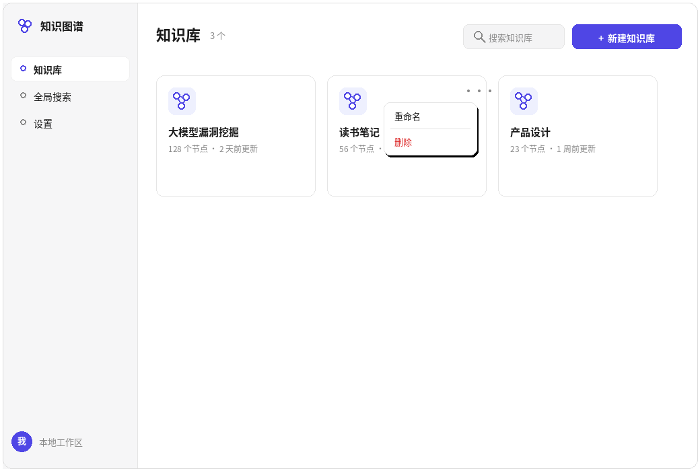
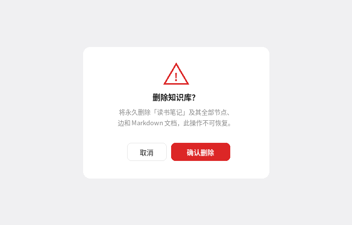
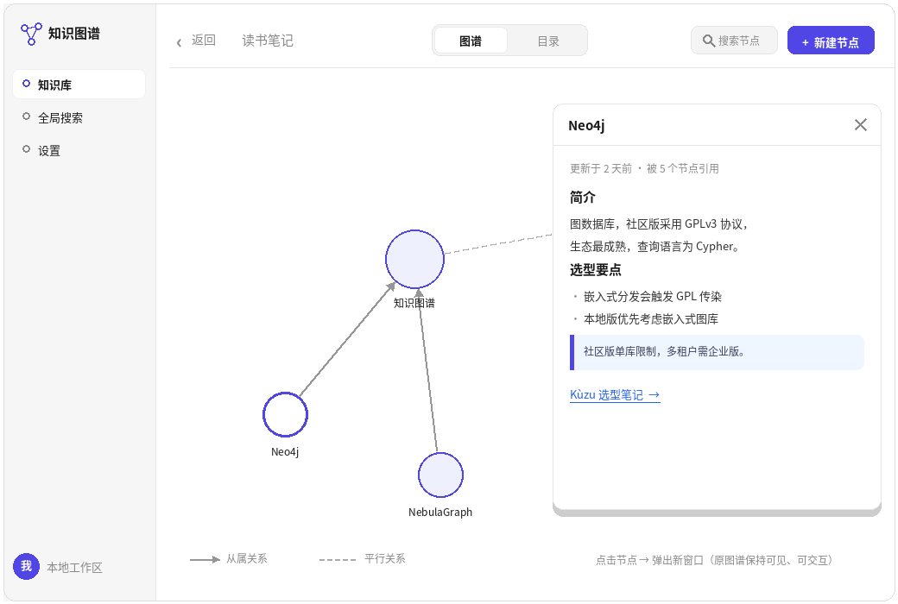
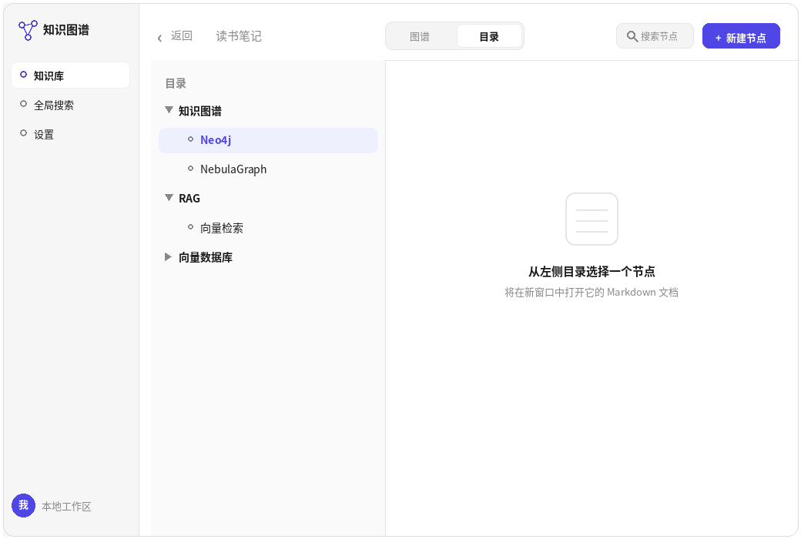
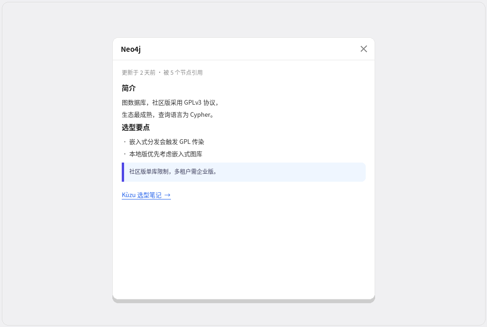

# 产品大纲：基于知识图谱的类 Notion 知识管理产品

> 状态：草稿 v0.2 ｜ 日期：2026-10-12 ｜ 修订：按用户要求精简为最小功能集
> 协作方式：新功能只由用户逐条确认后加入；项目细节由用户逐步补充，文档随之迭代

---

## 1. 一句话定位

一款以**知识图谱为底层数据模型**的个人 / 团队知识管理工具。
你写下的每个文档、每个概念，自动成为知识网络中的节点；关系自动建立、可视化、可查询。

- 对标 Notion 的"块编辑器 + 数据库"，核心差异是：**图谱是一等公民，而不是事后画出来的装饰**。

## 2. 背景与机会

- Notion 的关系是手动维护的（relation 属性）；Obsidian 的图谱只是事后可视化，不参与检索和推理。市面上缺少"写入即建图"的产品。
- LLM 让实体 / 关系自动抽取的成本大幅下降，自动建图在技术上第一次变得可行。
- 结合此前的结论：产品采用 Apache-2.0 开源（用户已确认）+ 上架微软商店分发，开源与商业化不冲突。

## 3. 目标用户

- **P0**：个人知识管理重度用户、研究人员、学生（论文 / 资料 / 笔记织成网络）
- **P1**：小团队知识库（研发、产品团队）
- **P2**：开发者（API / 插件生态）

## 4. 核心概念与数据模型（图谱优先，这是立身之本）

### 4.1 节点类型（初版）
- `Page`：页面
- `Concept`：自动抽取出的实体 / 概念（如"知识图谱""RAG"）；**后台节点，前端不展示**，仅供 GraphRAG 与检索使用；通过 `CHILD_OF` 边从属于文档
- `Tag`、`File`、`Person`、`Task`：标签、附件、人物、任务

### 4.2 边类型（初版，2026-10-13 收敛）
- `CHILD_OF`：子 → 父（方向固定为子节点指向父节点）
- `SIBLING_OF`：平行 / 同级关系（对称关系）

**设计决策（2026-10-13）**：图数据库只存从属和平行两种边。引用关系不存边——文档内的 `node:<id>` 内部链接即引用，点击直接跳转，无需在图库中建边。同义概念不做边，做"概念合并"操作（节点合并、边重定向）。自动抽取引擎只产出从属和平行两种边；抽取到的弱关联不入库，仅用于"相关文档"推荐与搜索排序。

**设计决策（2026-10-13）**：从属关系用**边类型**表达，不用"属性=1 开关"。`A -[:CHILD_OF]-> B` 即表示 A 是 B 的子节点——"谁是谁的子"由边类型 + 方向唯一确定，查询时按类型遍历即可，无需再判断属性值。

**设计决策（2026-10-13）**：关系分两大类 —— 从属关系（`CHILD_OF`，有向，方向固定子→父）与平行关系（`SIBLING_OF`，对称）。对称关系查询时忽略方向（双向遍历）；写入时按节点 ID 排序固定方向，避免存两条重复边。

**建模原则**：关系的语义（是什么关系）用边类型表达；数值和修饰（权重、置信度、时间）用边属性表达。所有边类型的方向都要有全局约定（如 CHILD_OF 固定子→父）。

### 4.3 与 Notion 的根本差异
- Notion：文档是主体，关系是挂在文档上的属性。
- 本产品：**节点即文档**，图谱直接由文档和概念节点构成，没有更细粒度的块节点；
- 图谱原生支持的查询示例：
  - "与《涌现》视频相关的所有概念"
  - "从概念 A 到概念 B 的最短路径"
  - "最近一周新增的、与'漏洞挖掘'相关的笔记"

**设计决策（2026-10-13）**：节点与 Markdown 文档 1:1 对应。每个节点的内容都由一份 Markdown 文档承载；图谱视图中点击任意节点，即打开其对应的 Markdown 文档。图数据库只存结构（节点、边、属性），文档正文存在文件 / 文档存储中，以节点 ID 关联（见 6.5）。

**设计决策（2026-10-13）**：每个节点暴露稳定链接。节点 ID（UUID）全局唯一，改名不失效；Markdown 内以内部链接形式引用其他节点（如 `[文字](node:<id>)`），渲染器拦截后跳转到目标节点的文档（利用上面的 1:1 映射）。导出 Markdown 时重写为相对文件链接，保证可移植。

### 4.4 知识库容器模型

**设计决策（2026-10-13）**：应用支持创建多个图知识库。每个知识库有一个名字，名字不是节点，只是容器的标识。每个知识库下可有多个顶级节点，这些顶级节点之间互为平行关系（`SIBLING_OF`）；深层节点通过 `CHILD_OF` 组织，平行关系仅限顶级节点。

- 校验规则：建 `SIBLING_OF(a, b)` 边时，a、b 须属于同一知识库且均为顶级节点（即没有 `CHILD_OF` 出边），否则拒绝写入。节点属性中记录所属知识库 ID。
- 该模型下不需要虚拟根节点：顶级节点的"同级"由"同属一个知识库"直接定义。

## 5. 功能大纲（最小集）

> 规则：以下只保留最小功能集。任何新功能只在用户明确提出后加入第 5.5 节的候选池，经确认再排期。

### 5.1 块编辑器
- Block-based 编辑，Markdown 快捷输入，所见即所得
- 常用块：文本、标题、待办、表格、代码、引用、文件、嵌入
- 说明（2026-10-13）：此处的"块"仅指编辑器内的内容单元，**不对应图节点**；数据模型中没有块级节点（用户确认）

### 5.2 自动建图引擎（核心差异化）
- 写入时实时管线：实体识别 → 概念节点生成 → 关系抽取 → 自动连边
- 无需手动 `[[ ]]` 也能发现关联；反向链接自动聚合
- 实体对齐 / 去重，人在回路（用户可确认 / 修正 / 删除边）

**设计决策（2026-10-13）**：抽取流程 = 保存文档 → LLM 抽取实体（JSON：名称、类型、简介）→ 对齐去重（命中已有 Concept 则合并 / 复用）→ 新建 Concept 节点并以 `CHILD_OF` 从属于文档。Concept 节点及其边**不在图谱 / 目录视图中展示**，只留作 GraphRAG 和检索用；可见图谱只呈现用户创建的结构（从属、平行）。

**设计决策（2026-10-13）**：自动建图引擎默认关闭。设置页提供总开关，用户手动开启后才执行抽取；LLM 来源也在设置页配置。用户已确认先使用可配置的云端 API，目标包括 DeepSeek、OpenAI（GPT）、Google Gemini、MiMo 等，不固定一家供应商。默认供应商、具体模型和首次实测配置待定；本地模型留待后续确认。

### 5.3 图谱可视化与探索
- 全局知识图谱（力导向布局，可缩放、筛选）
- 以任意节点为中心的邻域探索（1–3 跳）
- 路径查询、子图导出为图片 / 数据

### 5.4 Markdown 导入 / 导出
- 导入：Markdown 文件夹、CSV
- 导出：Markdown、JSON（含图谱结构，避免数据锁定）

### 5.5 候选功能池（待用户逐条确认，暂不排期）
- 数据库视图（表格 / 看板 / 日历 / 画廊）
- 智能问答与语义搜索（GraphRAG 思路，答案溯源到具体节点 / 文档）
- 协作与权限（工作区、分享、评论、版本历史）
- 移动端

### 5.6 界面布局

**首页（知识库列表）线框已确认（2026-10-13）**：

- 左侧边栏：应用标识、导航（知识库 / 全局搜索 / 设置）、底部本地工作区
- 主区顶部：标题"知识库" + 数量、搜索框、「新建知识库」按钮
- 知识库卡片：图谱徽标、库名、节点数、更新时间；悬停右上角 ⋯ 菜单 → 重命名 / 删除
- 新建：弹窗输入库名后创建；删除：二次确认弹窗（删除语义见 5.8）

  

**补充确认（2026-10-13）**：目录参考可折叠文件树；图谱和目录右键节点弹出同一操作菜单（新建子节点、重命名、关系管理、两种删除、新窗口打开）。目录移除行内加号和省略号，左右分栏可拖动；顶部按钮为“新建顶级节点”。

**知识库详情页（2026-10-13，多次修订）**：顶部栏含返回、库名、视图切换器（图谱 | 目录）、节点搜索、「新建节点」按钮。两种视图一键切换：
- 图谱视图：圆形节点 + 边，全宽画布；实线箭头 = 从属关系（子→父），虚线 = 平行关系；附图例

  
- 目录视图：左侧树形目录（可展开/折叠，缩进表示从属），右侧 Markdown 编辑器；左键选择后直接编辑和保存，两栏之间可拖动。未选中节点时右侧空状态。

  

**设计决策（2026-10-13，本次修订）**：图谱左键点击节点以**新窗口**打开 Markdown；目录左键在右侧编辑和保存，右键菜单也可选择在新窗口打开。原图谱 / 目录视图保持可见、可交互，无需返回。文档窗口含标题栏（文档名 + 关闭按钮），正文由集成的开源 Markdown 编辑器渲染，支持内部链接跳转。

**设计决策（2026-10-13）**：文档编辑器直接集成开源方案，不自研。候选均为 MIT 协议、可商用（已核实）：首选 **Milkdown**（markdown 原生，所见即所得，输入输出都是 markdown 字符串，与"节点 1:1 对应 markdown 文件"天然契合，插件化，基于 ProseMirror）；备选 **Vditor**（国产 b3log 出品，所见即所得 / 即时渲染 / 分屏三种模式，对中文友好）。

**选型分析（2026-10-13，用户暂不定，记录备查）**：
- Milkdown（推荐）：Markdown 原生，输入输出均为 Markdown 字符串，与数据模型同构，存什么编什么，无转换损耗；ProseMirror 底座 + 插件化，可定制 `node:` 内部链接渲染拦截等需求；MIT，2026 年仍在维护。
- Vditor（备选）：中文社区成熟，三种模式开箱即用；Markdown 保真度与定制天花板不及 Milkdown。
- TipTap / BlockNote（出局）：内容模型为 JSON，每次保存需转 Markdown，有转换损耗风险，`node:` 这类定制语法最易在转换中丢失，与"节点 1:1 对应 Markdown 文件"的数据模型不契合。但其块式编辑体验（slash 菜单、按块排版）值得借鉴——Milkdown 同样按 ProseMirror node 组织内容，可实现同类交互；"块"仅为编辑体验，数据模型中无块节点（2026-10-13 用户确认）。

### 5.7 开放 API（AI 可操作）

**设计决策（2026-10-13）**：API 从候选池转正为核心组件。目标是让 AI 能完整操作应用，增删改查全覆盖：
- REST API：知识库 / 节点 / 边 / 文档的 CRUD，以及图谱查询（邻域遍历、路径查询、全文搜索）
- MCP Server：把常用操作封装为标准工具（如 `create_node`、`update_doc`、`query_neighbors`、`search`），AI 助手可直接调用 —— 这是"AI 原生"的关键，也是相对 Notion / Obsidian 的差异化
- 鉴权：本地版用 API Key，默认只监听 localhost；云端版用 token + 权限范围
- 原则：所有 UI 操作都走同一套 API，保证 API 能力与界面能力一致，不阉割

**REST API 说明（2026-10-13）**：REST（Representational State Transfer）是一种网络 API 设计风格：万物皆资源（用网址标识），用标准 HTTP 动词表示操作（GET 查、POST 新建、PUT/PATCH 改、DELETE 删），无状态（每次请求自带身份信息如 API Key），数据用 JSON 传输。通用性强，任何语言、脚本、AI 都能调用。

本产品的 REST 接口示例：

| 方法 | 路径 | 说明 |
|---|---|---|
| GET | `/api/kbs` | 查所有知识库 |
| POST | `/api/kbs` | 新建知识库 |
| DELETE | `/api/kbs/{id}` | 删除知识库 |
| GET | `/api/kbs/{id}/nodes` | 查某库的节点 |
| POST | `/api/nodes` | 新建节点 |
| GET | `/api/nodes/{id}` | 读节点（含文档） |
| PATCH | `/api/nodes/{id}` | 改节点 / 文档 |
| DELETE | `/api/nodes/{id}` | 删节点 |
| POST | `/api/edges` | 建边 |
| DELETE | `/api/edges/{id}` | 删边 |
| GET | `/api/nodes/{id}/neighbors` | 查邻居节点（可指定边类型、跳数） |
| GET | `/api/search?q=...` | 全文 / 语义搜索 |

**设计决策（2026-10-13）**：MCP 工具层是图谱规则的统一执行入口。所有写入（UI、自动建图引擎、外部 AI）都经过同一套带校验的工具，规则写清楚、机器可读：
- `SIBLING_OF`：仅同一知识库的顶级节点之间（无 `CHILD_OF` 出边）；写入按节点 ID 排序固定方向
- `CHILD_OF`：方向固定子→父；禁止成环
- 边的两端必须属于同一知识库
- 违规时返回结构化错误（含原因 + 建议替代操作，如"深层节点不可建平行边：请先提升为顶级节点，或改用文档内 `node:` 链接引用"），让 AI 可以自纠正

### 5.8 删除语义

**设计决策（2026-10-13）**：删除采用软删除 + 回收站，30 天后自动彻底删除，期间可恢复：
- 删节点：可选“仅删除当前节点”或“级联删除”。前者保留子节点；后者递归删除独占后代，但保留有外部父节点的共享后代及其依附分支（用户确认）。被删节点的关联边级联清除，正文随节点进入同一个回收站批次，可整批恢复。
- 其他文档中指向该节点的内部链接（`node:<id>`）渲染为灰色"已删除节点"占位，不可点击
- 删知识库：二次确认后整库（节点、边、文档）进回收站，同样 30 天可恢复
- 注：删除确认弹窗 mockup（`kb-del.png`）需按新语义重画，文案改为"将进入回收站，30 天后彻底删除"

## 6. 技术架构大纲

### 6.1 前端
- 桌面端：Tauri（比 Electron 轻，打包体积小，适合上架微软商店的 MSIX）或 Electron
- 块编辑器：按 5.6 和 Phase 0 授权先使用 Milkdown（旧 TipTap / BlockNote 候选不采用）
- 图谱可视化：**Cytoscape.js（用户于 2026-10-13 确认）**

### 6.2 后端
- API 服务、实时协作（CRDT，如 Yjs）、文件存储

### 6.3 图数据库选型（关键决策，Phase 0 必须验证）

| 方案 | 协议 | 特点 | 注意事项 |
|---|---|---|---|
| Neo4j 社区版 | GPLv3 | 生态最成熟，Cypher 查询 | 嵌入式分发会触发 GPL 传染；闭源商用需购买商业许可。仅作独立进程调用相对安全 |
| NebulaGraph | Apache 2.0 | 国产，分布式，超大规模 | 早期版本曾附加 Commons Clause，选新版；是服务端集群形态，不适合单机嵌入 |
| Kùzu | MIT | 嵌入式图数据库（DuckDB 思路），Cypher + 向量检索，零运维 | 原官方仓库 2025-10 已归档，靠社区 fork 维护；选型前再确认活跃度 |
| ArangoDB | Apache 2.0 | 多模型（文档 + 图 + KV），一库多用 | 图查询能力弱于原生图库 |

- **选型建议**：桌面本地版优先嵌入式（Kùzu 一类，零运维、随应用分发）；云端 SaaS 再考虑服务端图库（NebulaGraph / Neo4j）。
- **协议红线**：GPL / AGPL 组件只做独立进程调用、不嵌入分发；主仓库保持宽松协议。

### 6.4 LLM 层
- 职责：实体 / 关系抽取、自动打标、问答生成
- 模型策略：先对接可配置的多家云端 API（DeepSeek、OpenAI/GPT、Google Gemini、MiMo 等，用户已确认）；默认模型待定，本地模型待后续确认
- 成本控制：增量抽取、结果缓存、人在回路减少无效调用

### 6.5 混合存储
- 图谱（关系，图数据库）+ 文档（Markdown 文件，与节点 1:1 对应）+ 向量（语义检索），三者以节点 ID 关联

## 7. 开源策略

- 主仓库采用 **Apache-2.0**（用户已确认，根目录 LICENSE 已落地）：对商业友好，利于生态与上架应用商店。
- AGPL 代码只借鉴思路，不直接引入（传染风险）。
- Open Core 划分：核心编辑器 + 本地图谱开源；云同步、团队协作、高级 AI 功能闭源收费。

## 8. 商业模式

- **免费**：本地单机版全功能（获客，口碑传播）
- **订阅**：云同步 + AI 额度（个人 Pro / 团队版）
- **企业**：私有部署、定制开发
- 前提已验证：开源不妨碍收费（2026-10-12 结论）

## 9. 分发渠道

- Web 版、桌面端（微软商店上架：无需软著，开源可上架，需拥有分发权并履行协议义务）
- 移动端（二期，待确认）

## 10. 竞品分析

- **Notion**：块编辑器 + 数据库的标杆；弱点是关系全靠手动维护，无原生图谱。
- **Obsidian**：本地 Markdown + 图谱可视化；弱点是图谱只是展示层，不参与检索推理。
- **Logseq**：大纲 + 双向链接，开源（AGPL）。
- **AFFiNE**：开源类 Notion（官方仓库 LICENSE 为 AGPL-3.0），块编辑器 + 白板；数据模型仍是文档优先，无图谱优先设计。
- **Anytype**：本地优先、对象化的知识管理。
- **差异化一句话**：别人是先有文档再画图，我们是图谱即数据库。

## 11. 路线图（阶段式）

- **Phase 0（技术验证）**：块编辑器 + 嵌入式图库跑通"写入即建图"最小闭环；确定图库选型。
- **MVP**：本地单机版 —— 第 5 节最小功能集。
- **Beta**：云同步、分享协作、一键迁移（待用户确认后排期）。
- **1.0**：插件生态、微软商店上架。

## 12. 风险与开放问题

- 自动抽取准确率：噪音边太多会污染图谱 → 置信度阈值 + 人在回路。
- 图谱规模增长后的查询 / 渲染性能。
- 冷启动：新用户无数据时图谱价值为零 → 靠导入迁移解决。
- 图数据库选型一旦确定很难更换 → Phase 0 重点验证。
- 与 Notion / Obsidian 之间的用户迁移成本。

## 13. 下一步行动

- [ ] 用户逐步补充项目细节，文档随之迭代（进行中）
- [ ] 确定产品代号与域名
- [x] Phase 0 技术验证：Milkdown + Kùzu + Tauri 跑通，结果见 PROGRESS.md
- [x] 确定主仓库开源协议：Apache-2.0
- [ ] 细化 Open Core 的开源/商业模块边界
- [ ] 每日 8 点产品建议已开启（见目标）
